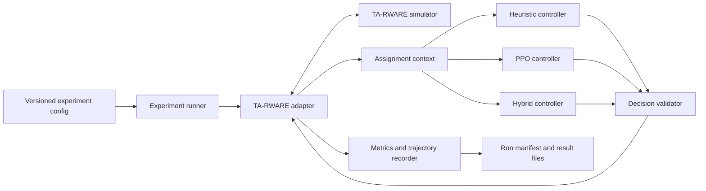
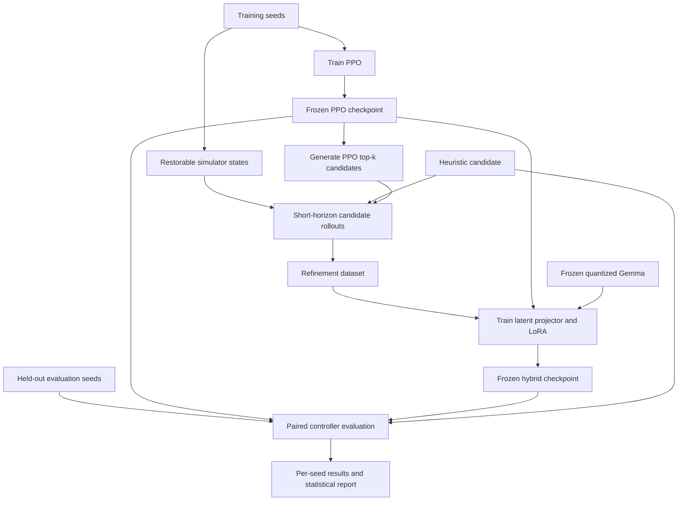
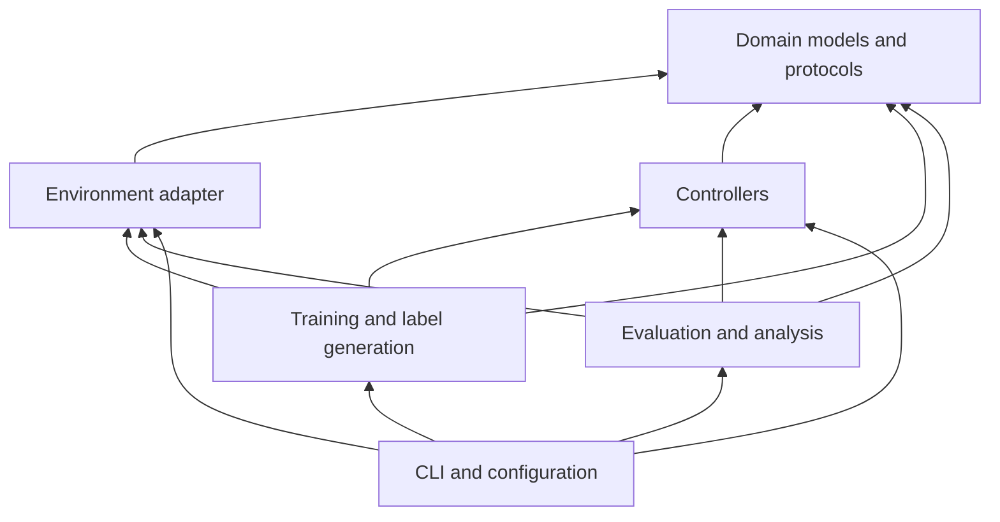

# Architecture

## Purpose

This document defines the intended system boundaries before implementation. It
does not claim that TA-RWARE exposes methods with these names. The compatibility
spike must map its real interfaces into the project-owned concepts below.

The central rule is that TA-RWARE-specific objects remain inside the environment
adapter. Controllers, training code, dataset generation, and evaluation operate
on project-owned domain models.

## System context



Every evaluated controller receives equivalent state information, eligible
assignments, episode settings, and random seeds. The validator is mandatory for
LLM output and should also assert decisions from deterministic controllers.

## Training and evaluation flow



Training, validation, and final evaluation seed sets are disjoint. Final seeds
must not influence prompts, hyperparameters, checkpoints, label generation, or
fallback rules.

## Layering and dependency direction



Lower layers never import the CLI, training orchestration, or analysis code.
Domain models do not depend on TA-RWARE, Stable-Baselines3, Transformers, Typer,
or filesystem formats.

## Conceptual interfaces

These are behavioral contracts. Exact Python signatures and fields are finalized
after TA-RWARE inspection.

### Environment wrapper

`TarwareEnvWrapper` owns the simulator and all TA-RWARE translation. It must
support:

- `reset(seed, environment_config)` returning an initial project-owned state.
- `decode(model_output)` converting a one-dimensional integer destination
  vector into a validated `JointAction`.
- `step(joint_action)` accepting only project-owned actions and returning a
  project-owned observation plus simulator results.
- Reading an `AssignmentContext` at each assignment event.
- Enumerating all currently eligible robot-task pairs.
- Validating and applying an `AssignmentDecision`.
- Advancing low-level navigation until the next decision event or termination.
- Reporting termination, truncation, deadlock, and simulator errors distinctly.
- Producing step and episode metrics.
- Snapshot/restore for candidate rollouts, or a deterministic replay substitute
  if TA-RWARE cannot clone state.

The compatibility spike rejected pickle snapshots: independent clones diverged
under identical recorded action suffixes. The selected substitute is reset from
an explicit seed plus replay of the recorded action prefix, followed by an
observable-state equality check.

No controller may access hidden future orders or internal simulator state that is
unavailable to the other controllers.

### Controller

All controllers implement one conceptual operation:

```text
choose_assignment(context: AssignmentContext) -> AssignmentDecision
```

The heuristic and PPO controllers should be deterministic during evaluation.
The hybrid uses deterministic decoding where the selected model supports it.

### Domain records

- `WarehouseObservation`: canonical global state shared by every controller,
  containing ordered agent and shelf-location records.
- `AgentAction`: one agent's macro destination; destination zero means no new
  assignment.
- `JointAction`: exactly one `AgentAction` for every agent in canonical order.
- `ActionMask`: the per-agent destination mask, strengthened by project-owned
  joint-action validation.
- `EligibleAssignment`: one currently legal robot-task pairing.
- `AssignmentContext`: state, eligible assignments, episode step, and identifiers
  required for logging.
- `AssignmentDecision`: selected pairs, optional reason, latency, validation
  status, retry count, and fallback status.
- `StepMetrics`: distance, idle time, task progress, failures, and timing for one
  simulator interval.
- `EpisodeMetrics`: aggregate primary and secondary outcomes for one seed.
- `RunManifest`: provenance needed to reproduce an entire command.

Identifiers must remain stable within an episode and must serialize without
Python-specific object representations.

TA-RWARE macro-actions select destination locations, not persistent task
objects. Domain and adapter code therefore use destination terminology. A later
task abstraction may map warehouse work onto those destinations without
changing the simulator contract.

`WarehouseObservation.encode()` performs deterministic feature serialization
and contains no learned parameters. The future PPO feature extractor consumes
that vector and produces the learned latent used by both PPO and the hybrid.
Its docstring defines the model-facing feature contract.

The core PPO controller is centralized: one observation produces one joint
destination action. Busy agents must select destination zero. Per-agent masks
are necessary but not sufficient; validation also rejects same-role agents
selecting the same nonzero destination in one joint action. An AGV and picker
may share a shelf destination because that is required for cooperation.

### Run manifest

Every authoritative run records:

- Run ID, command, UTC creation time, and experiment name.
- Git commit and whether the worktree was dirty.
- Full resolved configuration and schema version.
- Training, validation, or evaluation seed set.
- Python and dependency lock information.
- Operating system, CPU, GPU, driver, and accelerator information.
- TA-RWARE commit and environment configuration.
- PPO checkpoint digest.
- Hugging Face repository IDs and immutable artifact revisions.
- Output file paths, status, duration, and failure summary.

## Controller behavior

### Heuristic

The deterministic heuristic provides a baseline and one candidate for rollout
label generation. Its scoring rule is chosen after inspecting TA-RWARE and then
locked before final experiments. It cannot use privileged state.

### PPO

Stable-Baselines3 is the default implementation. The policy integration must
expose the frozen encoder latent, valid-action-masked scores, preferred action,
and value estimate without maintaining a second independently trained PPO model.
SB3-Contrib's `MaskablePPO` accepts the centralized `MultiDiscrete([55] * 5)`
space and a flattened 275-value mask. Its mask is component-wise and cannot
express same-role duplicate destinations. The PPO-only adapter therefore keeps
the lowest canonical agent's choice, changes later duplicates to no-op, and logs
each repair. Strict controller decisions continue through rejection-based
validation.

The isolated directive-demo exception has a separate repository-owned PPO backend.
`demo/ppo/policy.py` selects a lazy policy adapter: the active checkpoint uses a
plain PyTorch model, while the preserved schema-v1 SB3 reference imports SB3
only when requested. Rollout math, storage, collection, training, validation,
and model structure have one-way module boundaries under `demo/ppo/`. Lightning
Fabric is imported only inside training orchestration. This prototype boundary
does not replace the main project's PPO architecture decision.

The untrained schema-v4 extension composes independent policy and value `Mlp`
modules from a shared config-owned `hidden_sizes` sequence. Linear layers live
in `nn.ModuleList`, `tanh` is applied only between layers, and the final hidden
activation remains the exposed latent. Its initial `[64]` setting is
mathematically equivalent to the schema-v3 branch shape. Historical schema-v2
and schema-v3 checkpoints keep their identities and load through an explicit
one-layer state-key migration.

The rest of the demo follows the same small-boundary layout:

```text
demo/
|-- contracts/       # Strict records grouped by subsystem
|-- directives/      # Catalog-owned Directive semantics, engine, and live probe
|-- ppo/             # Model, adapters, rollout storage/math, training, validation
|-- inference/       # ModelBackend, llama.cpp adapter, prompt, preflight
|-- evaluation/      # Episode loop, artifact verification, matched runner
|-- controllers.py   # Shared validator/pipeline and action-source strategies
`-- artifacts.py     # Canonical JSON, hashes, atomic and append-only writes
```

All package initializers are minimal. Importing contracts or configuration must
not import Torch, Lightning, SB3, or httpx. `GemmaActioner` parses untrusted
messages but never receives a simulator wrapper. `ActionValidator` performs the
single stale-state, vector, wrapper-decode, canonical-order, and directive-effect
validation pass before one controller pipeline chooses deterministic fallback.

### Rollout label generator

For each selected training state, compare PPO's top valid candidates with the
heuristic candidate using identical short-horizon conditions. Candidate count,
horizon, continuation controller, score, and tie-breaking are configuration
values fixed before dataset generation.

If cloning is unavailable, reconstruct a state by replaying a seed and recorded
decision prefix. Verify that replay reaches the same observable state before
using its label.

### Hybrid

The hybrid freezes PPO and the quantized base Gemma model. It trains:

- A projector from one PPO latent vector to a fixed sequence of Gemma embedding
  vectors.
- LoRA adapters on an explicitly configured subset of Gemma modules.

The LLM also receives a compact textual state and explicit eligible assignments.
It returns structured robot-task pairs and a short reason. Invalid output gets
one corrective retry; a second failure falls back to PPO's highest-ranked valid
choice. All retries and fallbacks are measured.

## Future package structure

```text
src/warehouse_ai/
|-- domain/          # Framework-independent records, protocols, and validation
|-- env/             # TA-RWARE wrapper and state serialization
|-- controllers/     # Shared controller protocol and heuristic implementation
|-- ppo/             # PPO policy integration, training, and checkpoints
|-- hybrid/          # Projector, prompting, LoRA, decoding, and fallback
|-- data/             # Rollout label generation and dataset manifests
|-- evaluation/       # Metrics, paired runs, statistics, plots, and replay
|-- config/           # Pydantic schemas and YAML loading
`-- cli.py            # Typer application composition only
```

Tests should mirror these boundaries. Notebooks may import the package for
analysis but cannot contain the only implementation of training or evaluation.

## Unresolved compatibility outputs

The first technical milestone must replace these unknowns with pinned facts:

- Supported Python and dependency versions.
- TA-RWARE observation, assignment action, reward, and rendering behavior.
- Multi-agent representation and valid-action masking requirements.
- Snapshot/restore feasibility and determinism.
- Smallest meaningful standard environment configuration.
- Exact Gemma Hugging Face ID, revision, license, quantization, and memory use.
- Embedding injection and quantized LoRA compatibility.

